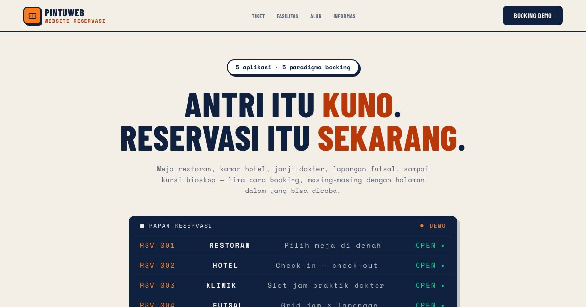

# PortalReservasi — Lima Cara Mengambil Antrian

PortalReservasi: 5 aplikasi booking dengan paradigma berbeda — restoran, hotel, klinik, futsal, dan bioskop.

**Demo live:** https://www.pintuweb.id/website-reservasi



> Katalog demo milik PintuWeb. Setiap kartu menautkan ke demo live yang bisa dicoba.

## Konsep

Katalog aplikasi reservasi. Gaya boarding pass: papan keberangkatan di hero dan kartu tiket berperforasi.

## Varian yang dipamerkan (5)

Slug kartu = alamat tautan langsung (`/website-reservasi#<slug>`); gulir ke kartu, sorot cincin oranye ±2 detik.

- `restoran`: [Pawon Lirih](https://reservasi-restoran.pintuweb.id), denah meja
- `hotel`: [Tanjung Lengkung](https://reservasi-hotel.pintuweb.id), check-in/check-out
- `klinik`: [Klinik Rumpun Waras](https://reservasi-klinik.pintuweb.id), slot dokter (tangkapan penuh; potret dokter berwajah polos)
- `futsal`: [Gelanggang Petang](https://reservasi-futsal.pintuweb.id), grid jam x lapangan
- `bioskop`: [Bioskop Kelir](https://reservasi-bioskop.pintuweb.id), peta kursi

Gambar kartu: `public/images/rsv/<slug>.webp` (desktop 1600x1000) dan `<slug>-m.webp` (potret ponsel 780x1688, dipakai < 768 px lewat `<picture>`). Varian lebar dibuat `node scripts/gambar-varian.mjs`; untuk berkas `-m` hapus varian 800/960/1280 (sama dengan aslinya). Sumber tangkapan: `public/images/SUMBER.md`.

## Halaman

`/`

## Teknologi

- Next.js 15.5 (App Router) dan React 19
- Tailwind CSS v4
- JavaScript
- Framer Motion, Lucide (ikon)
- Font: Barlow Condensed, Space Mono (next/font)
- SEO: metadata per halaman, Open Graph, JSON-LD, sitemap.xml, dan robots.txt

## Menjalankan secara lokal

```bash
npm install
npm run dev
```

Buka http://localhost:3000. Untuk build produksi: `npm run build` lalu `npm start`.

---

Dibuat oleh [PintuWeb](https://www.pintuweb.id), jasa pembuatan website.
